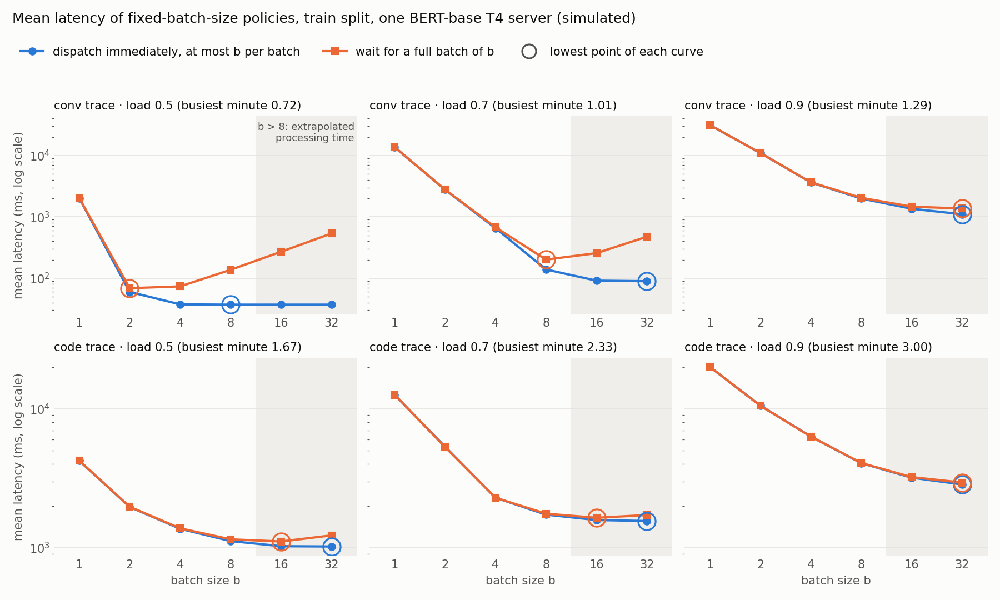

# Adaptive Batching for ML Inference Serving

**Research question:** under real arrival patterns, when does a learned batching
policy beat a well-tuned heuristic?

An inference server groups requests into batches. Larger batches use the
accelerator more efficiently but make every request in the batch wait longer.
This project compares reinforcement-learning policies (DQN and PPO, from
Stable-Baselines3) against tuned rule-based policies for choosing when to
dispatch a batch and how large it should be.

> **Scope.** Arrival times are replayed from a production LLM-service trace,
> but the processing-time model describes whole-batch inference of an
> encoder-type service (embedding, classification, re-ranking). It does not
> represent the continuous, token-level batching used to serve generative LLMs.

> **Status: rework in progress.** This repository started as a Spring 2026
> reinforcement-learning course project at SJSU. Its headline result did not
> hold up (see below), so the simulator and the experiments are being rebuilt.
> The simulator exists; **no learned policy has been evaluated yet**, so the
> research question is still open.

## Simulator sanity check: fixed batch sizes

The simulator is discrete-event: a server is occupied while it processes a
batch, and a request's latency is its queueing time plus its processing time.
Batch processing time is `fixed + per_token x batch_size x longest_sequence`,
with both parameters fitted to published BERT-base measurements on an NVIDIA
T4 (see [docs/decisions.md](docs/decisions.md), D7). The published
measurements cover batch sizes 1-8; **batch sizes 16 and 32 are a linear
extrapolation**.

Mean latency of fixed-batch-size policies on the **train** split (simulated,
one server), for two ways of using a fixed size b: "greedy cap" dispatches
immediately with at most b requests; "full batch" waits until b requests are
queued (at most one second).

<!-- BEGIN GENERATED: fixed-batch-sweep -->
| Trace | Nominal load | Load in busiest minute | No batching | Best greedy cap | Best full-batch size |
|---|---|---|---|---|---|
| conv | 0.5 | 0.72 | 2026 ms | b=8 (37 ms) | b=2 (69 ms) |
| conv | 0.7 | 1.01 | 13702 ms | b=32 (89 ms) | b=8 (201 ms) |
| conv | 0.9 | 1.29 | 31352 ms | b=32 (1101 ms) | b=32 (1367 ms) |
| code | 0.5 | 1.67 | 4235 ms | b=32 (1020 ms) | b=16 (1109 ms) |
| code | 0.7 | 2.33 | 12648 ms | b=32 (1557 ms) | b=16 (1643 ms) |
| code | 0.9 | 3.00 | 20060 ms | b=32 (2855 ms) | b=32 (2947 ms) |
<!-- END GENERATED: fixed-batch-sweep -->



What this shows: no batching is far from optimal at every load; waiting for
a full batch gives a U-shaped curve whose best size grows with load; and a
policy that never waits is not hurt by a large cap. Nominal load is computed
from the mean arrival rate, so bursts push the busiest minute well above it.
Reproduce with `make sweep`.

## What was wrong with the original result

The original multi-stage experiment reported that PPO clearly beat the
strongest heuristic on average job completion time (JCT). That conclusion is
not valid.

**How it was found.** The only static baseline in the original comparison was
batch size 8. Evaluating every fixed batch size with the original evaluation
protocol shows that simply always using the largest batch beats the reported
PPO result:

<!-- BEGIN GENERATED: legacy-fixed-batch -->
| Policy | Avg JCT (steps) | P99 JCT (steps) | Source |
|---|---|---|---|
| Fixed batch 1 | 439.32 | 868.63 | re-run |
| Fixed batch 2 | 379.41 | 749.34 | re-run |
| Fixed batch 4 | 260.32 | 516.53 | re-run |
| Fixed batch 8 | 34.30 | 63.70 | re-run |
| Fixed batch 16 | 2.38 | 4.30 | re-run |
| Fixed batch 32 | 2.04 | 3.00 | re-run |
| Fixed batch 64 | 2.00 | 2.00 | re-run |
| Threshold | 4.81 | 7.00 | re-run |
| Downstream-Aware | 5.32 | 7.90 | re-run |
| PPO (original run, not retrained) | 2.30 | 3.10 | stored |
<!-- END GENERATED: legacy-fixed-batch -->

**Why.** In the original multi-stage environment, the processing time of a
batch was computed and then never used: a batch of any size finished within
the same step and never occupied the server. With batching free, the largest
batch is always optimal, and "PPO beats the heuristics" only meant that the
hand-written threshold rule picked small batches when queues were short.

Other problems in the original code, all addressed by the rework:

- Baselines were weak and untuned (a single fixed batch size, hand-picked thresholds).
- The original README said the simulator's parameters came from the Azure LLM
  inference trace. They did not: the trace files were only read by an
  exploratory script, and arrival rates and latency parameters were hand-written.
- In the single-stage environment a step always represented a fixed time
  slice, even when the batch it dispatched took longer than that slice.
- The multi-stage experiment used one training seed.
- There were no tests and no CI.

The original code, scripts and results are kept unmodified in
[legacy/](legacy/) (see [legacy/README.md](legacy/README.md)). Reproduce the
table above with `make legacy-repro`.

## Rework plan

| Phase | Content | State |
|---|---|---|
| 0 | Archive old code, packaging, lint, tests, CI | done |
| 1 | Discrete-event simulator replaying the Azure trace timestamps, with train / dev / test splits | in progress |
| 2 | Tuned heuristic baselines vs. DQN / PPO, multiple seeds, paired bootstrap confidence intervals, ablations | not started |
| 3 | Real batching inference service (FastAPI, CPU model), trace replay load test, simulator-vs-real comparison | not started |

Design decisions and their reasons are recorded in
[docs/decisions.md](docs/decisions.md).

## Development

Requires Python 3.10+.

```bash
make setup   # create .venv and install with dev extras
make check   # ruff + pytest
make sweep   # fixed-batch-size sweep on the train split + figure
make docs    # regenerate generated blocks in README.md from results/
```

Every number in this README is written by `scripts/render_docs.py` from files
under `results/`; none is typed by hand.

## Data

`data/` contains two files from the
[Azure LLM Inference Trace 2023](https://github.com/Azure/AzurePublicDataset)
(code and conversation workloads): request timestamps with context and
generated token counts. Each covers roughly one hour of a single day, which
limits how far any conclusion drawn from them can be generalized.

## Attribution

The RL algorithms are used as implemented in
[Stable-Baselines3](https://github.com/DLR-RM/stable-baselines3). This
project's own work is the simulator, the state and reward design, the
baselines, and the experimental method.

## Team (original course project)

- Yumeng Ren — environment design and simulation
- Haoran Jiang — PPO and SAC agent implementation
- Brian Lam — DQN baseline, heuristic baselines, evaluation and reporting

The rework on top of the course project is by Haoran Jiang.
