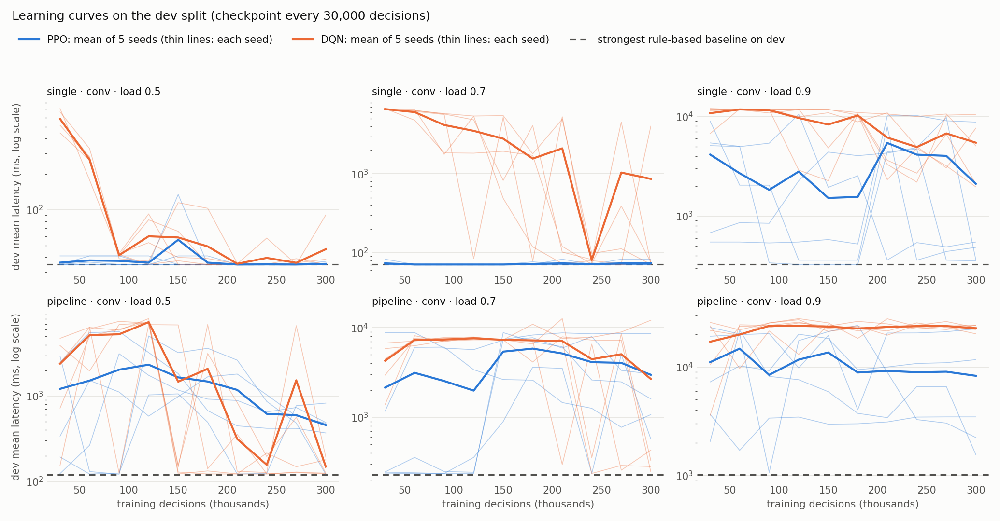
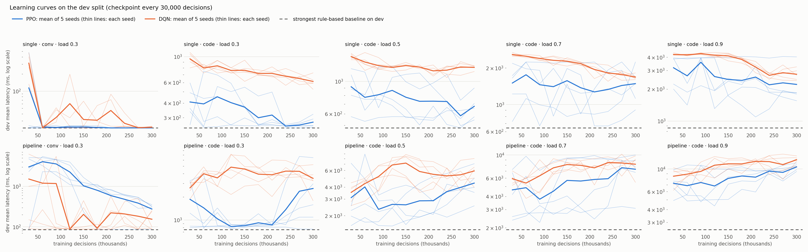

# Report: learned versus rule-based batching for inference serving

**Question.** Under real arrival patterns, when does a learned batching
policy beat a well-tuned rule?

**Scope.** Arrival times are replayed from a production LLM-service trace,
but the processing-time model describes whole-batch inference of an
encoder-type service (embedding, classification, re-ranking). It does not
represent the continuous, token-level batching used to serve generative LLMs.
Everything below is simulation.

## Conclusion

<!-- BEGIN GENERATED: report-conclusion -->
**Single stage.** With one server the learned policy never beat the tuned rule: in 8 single-stage conditions the pre-registered verdict was "no difference" 6 times and "RL worse" 2 times, and on the conversation trace the best learned policy reproduced the rule "never wait" almost exactly (largest difference in mean latency 0.0%).

**Pipeline.** In the three-stage pipeline the pre-registered primary comparison (conv, load 0.7, mean latency, PPO against the strongest rule) found the learned policy **worse**: +399.2% [+0.5, +947.8] on the test split. The cause is unstable training rather than a uniformly bad policy: 2 of 5 seeds failed (test mean latency above 2x the rule's), while the other 3 were within 0.8% of the rule. Over all 8 pipeline conditions the verdict was "RL worse" 7 times and "no difference" once. **In none of the 16 conditions was the learned policy better than the tuned rule.**

**Scope and data limits.** Arrival times come from about 1 hour of one day of an LLM-service trace; the test split is lighter than its nominal load (realised load 0.63 at nominal 0.9 on the conversation trace) and the code trace's test split has only 751 requests; the processing-time model describes whole-batch inference of an encoder model and is a linear extrapolation above batch size 8. The result is for DQN and PPO with a budget of 300,000 decisions per run.
<!-- END GENERATED: report-conclusion -->

## Setup

- **Simulator.** Discrete-event; a server is occupied while it processes a
  batch; latency is queueing plus processing. Batch time is
  `fixed + per_token x batch_size x longest_sequence`, fitted to published
  BERT measurements ([docs/decisions.md](docs/decisions.md), D7, D8).
- **Load.** Arrival rate divided by the capacity of the slowest stage at the
  largest batch. A load level is reached by compressing the trace's time
  axis with one factor computed on the train split (D9).
- **Rules.** Never wait (greedy, with a cap); wait for a full batch with a
  maximum delay; threshold (serve everything once k requests wait, with a
  maximum delay); and, for the pipeline, a threshold rule that also holds
  back while the next stage is backed up. All parameters are grid-searched
  on the dev split, per condition and per stage.
- **Learned policies.** DQN and PPO from Stable-Baselines3. Actions: wait,
  or dispatch at most 1, 2, 4, 8, 16 or 32 requests. The reward is minus the
  time integral of the number of requests in the system, so the return is
  the total latency. One policy per condition, five seeds, checkpoint chosen
  on dev.
- **Statistics.** Paired block bootstrap over request blocks and seeds, 95%
  intervals, verdicts defined in advance
  ([docs/preregistration.md](docs/preregistration.md)).

<!-- BEGIN GENERATED: report-setup -->
Trace splits (by time, before load scaling):

| Trace | Split | Requests | Minutes | Requests/s |
|---|---|---|---|---|
| conv | train | 12,340 | 35.0 | 5.87 |
| conv | dev | 4,155 | 11.7 | 5.93 |
| conv | test | 2,871 | 11.7 | 4.10 |
| code | train | 6,521 | 34.4 | 3.16 |
| code | dev | 1,547 | 11.5 | 2.25 |
| code | test | 751 | 11.5 | 1.09 |

Scenarios:

| Scenario | Stages | Capacity (requests/s) | Primary SLO (ms) | Tight SLO (ms) |
|---|---|---|---|---|
| single | one BERT-base server | 116.5 | 550 | 160 |
| pipeline | illustrative 3-stage pipeline: BERT-base, BERT-large, BERT-base | 40.6 | 2674 | 726 |
<!-- END GENERATED: report-setup -->

## Pre-registered results

The protocol was fixed and published before any policy was run on a test
split. Three deviations are recorded in the pre-registration: the reward was
re-expressed in a different unit after the first tuning round collapsed to
"always wait" (Deviation 1), a training-sufficiency check was added
(Deviation 2), and the exploratory analyses further below were added after
the primary test results had been seen (Deviation 3).

### Primary comparison

<!-- BEGIN GENERATED: report-primary-comparison -->
- Condition: pipeline, conv, load 0.7; test split of 2,871 requests.
- Strongest rule (chosen on dev): greedy(cap 1) / greedy(cap 16) / greedy(cap 2); test mean latency 119 ms.
- Best RL (chosen on dev): PPO; test mean latency of the five seeds: 796, 119, 1817, 120, 120 ms (average 595 ms).
- Mean latency, RL relative to the rule: **+399.2% [+0.5, +947.8]**.
- SLO violation rate, RL minus rule: +0.72 pt [+0.00, +2.52].
- Pre-registered verdict: **RL worse**.
<!-- END GENERATED: report-primary-comparison -->

### Primary conditions

Negative differences favour the learned policy. An interval entirely above
zero is "RL worse"; one containing zero is "no difference", marked
"equivalent" if it lies within +/-5% and "inconclusive" otherwise.

<!-- BEGIN GENERATED: report-primary-table -->
| Condition | Realised test load (busiest minute) | Strongest rule: mean latency, SLO misses | Best RL: mean of 5 seeds | Mean latency, RL vs rule [95% CI] | SLO misses, RL vs rule [95% CI] | Verdict |
|---|---|---|---|---|---|---|
| single, conv, load 0.5 | 0.35 (0.39) | 25.2 ms, 0.0% | PPO: 25.2 ms | +0.0% [-0.0, +0.0] | +0.00 pt [+0.00, +0.00] | no difference (equivalent) |
| single, conv, load 0.7 | 0.49 (0.54) | 33.5 ms, 0.0% | PPO: 33.5 ms | +0.0% [-0.0, +0.0] | +0.00 pt [+0.00, +0.00] | no difference (equivalent) |
| single, conv, load 0.9 | 0.63 (0.69) | 48.0 ms, 0.0% | PPO: 48.0 ms | +0.0% [-0.0, +0.0] | +0.00 pt [+0.00, +0.00] | no difference (equivalent) |
| pipeline, conv, load 0.5 | 0.35 (0.39) | 94.1 ms, 0.0% | DQN: 97.7 ms | +3.8% [+1.3, +9.7] | +0.02 pt [+0.00, +0.13] | RL worse |
| pipeline, conv, load 0.7 | 0.49 (0.54) | 119 ms, 0.0% | PPO: 595 ms | +399.2% [+0.5, +947.8] | +0.72 pt [+0.00, +2.52] | RL worse |
| pipeline, conv, load 0.9 | 0.63 (0.69) | 163 ms, 0.0% | PPO: 636 ms | +289.8% [-0.7, +887.9] | +10.16 pt [+0.00, +31.46] | no difference (inconclusive) |
<!-- END GENERATED: report-primary-table -->

### Secondary conditions

These cannot upgrade or downgrade the answer (pre-registration, Section 4).
The code trace is so bursty and its test split so small that it separates
policies poorly.

<!-- BEGIN GENERATED: report-secondary-table -->
| Condition | Realised test load (busiest minute) | Strongest rule: mean latency, SLO misses | Best RL: mean of 5 seeds | Mean latency, RL vs rule [95% CI] | SLO misses, RL vs rule [95% CI] | Verdict |
|---|---|---|---|---|---|---|
| single, conv, load 0.3 | 0.21 (0.23) | 19.6 ms, 0.0% | PPO: 19.6 ms | +0.0% [-0.1, +0.1] | +0.00 pt [+0.00, +0.00] | no difference (equivalent) |
| pipeline, conv, load 0.3 | 0.21 (0.23) | 78.8 ms, 0.0% | DQN: 79.6 ms | +1.0% [+0.6, +1.6] | +0.00 pt [+0.00, +0.00] | RL worse |
| single, code, load 0.3 | 0.10 (0.25) | 176 ms, 5.7% | PPO: 180 ms | +2.4% [-0.5, +6.0] | +1.76 pt [+0.00, +5.21] | no difference (inconclusive) |
| single, code, load 0.5 | 0.17 (0.42) | 309 ms, 17.6% | PPO: 359 ms | +16.0% [-0.1, +39.4] | +3.30 pt [+0.00, +10.07] | no difference (inconclusive) |
| single, code, load 0.7 | 0.24 (0.59) | 399 ms, 20.0% | PPO: 531 ms | +33.1% [+8.6, +63.3] | +15.47 pt [+3.13, +32.40] | RL worse |
| single, code, load 0.9 | 0.31 (0.75) | 515 ms, 32.6% | PPO: 667 ms | +29.4% [+7.6, +57.2] | +12.76 pt [+2.57, +25.86] | RL worse |
| pipeline, code, load 0.3 | 0.10 (0.25) | 535 ms, 0.0% | PPO: 560 ms | +4.7% [+1.6, +8.9] | +0.03 pt [+0.00, +0.16] | RL worse |
| pipeline, code, load 0.5 | 0.17 (0.42) | 928 ms, 10.3% | PPO: 1302 ms | +40.4% [+9.7, +84.5] | +7.83 pt [+0.21, +20.05] | RL worse |
| pipeline, code, load 0.7 | 0.24 (0.59) | 1198 ms, 13.7% | PPO: 2243 ms | +87.2% [+19.9, +224.4] | +16.40 pt [+0.64, +43.44] | RL worse |
| pipeline, code, load 0.9 | 0.31 (0.75) | 1479 ms, 14.8% | PPO: 2543 ms | +71.9% [+30.8, +130.1] | +23.12 pt [+8.33, +41.28] | RL worse |
<!-- END GENERATED: report-secondary-table -->

### Both algorithms (secondary)

<!-- BEGIN GENERATED: report-both-algorithms -->
| Condition | Best RL (by dev) | PPO vs rule | DQN vs rule |
|---|---|---|---|
| single, conv, load 0.5 | PPO | +0.0% [-0.0, +0.0], no difference (equivalent) | +0.8% [+0.0, +3.0], no difference (equivalent) |
| single, conv, load 0.7 | PPO | +0.0% [-0.0, +0.0], no difference (equivalent) | +3.1% [+0.7, +7.2], RL worse |
| single, conv, load 0.9 | PPO | +0.0% [-0.0, +0.0], no difference (equivalent) | +549.0% [+38.3, +1573.7], RL worse |
| pipeline, conv, load 0.5 | DQN | +167.2% [+0.9, +363.9], RL worse | +3.8% [+1.3, +9.7], RL worse |
| pipeline, conv, load 0.7 | PPO | +399.2% [+0.5, +947.8], RL worse | +174.4% [+2.0, +521.2], RL worse |
| pipeline, conv, load 0.9 | PPO | +289.8% [-0.7, +887.9], no difference (inconclusive) | +1433.7% [+193.9, +2786.8], RL worse |
| single, conv, load 0.3 | PPO | +0.0% [-0.1, +0.1], no difference (equivalent) | +0.0% [-0.0, +0.1], no difference (equivalent) |
| pipeline, conv, load 0.3 | DQN | +327.7% [+158.5, +434.1], RL worse | +1.0% [+0.6, +1.6], RL worse |
| single, code, load 0.3 | PPO | +2.4% [-0.5, +6.0], no difference (inconclusive) | +87.3% [+43.4, +112.1], RL worse |
| single, code, load 0.5 | PPO | +16.0% [-0.1, +39.4], no difference (inconclusive) | +142.7% [+119.8, +190.6], RL worse |
| single, code, load 0.7 | PPO | +33.1% [+8.6, +63.3], RL worse | +176.5% [+136.8, +250.5], RL worse |
| single, code, load 0.9 | PPO | +29.4% [+7.6, +57.2], RL worse | +139.8% [+120.3, +171.4], RL worse |
| pipeline, code, load 0.3 | PPO | +4.7% [+1.6, +8.9], RL worse | +181.5% [+118.8, +248.5], RL worse |
| pipeline, code, load 0.5 | PPO | +40.4% [+9.7, +84.5], RL worse | +105.3% [+73.0, +148.2], RL worse |
| pipeline, code, load 0.7 | PPO | +87.2% [+19.9, +224.4], RL worse | +121.3% [+92.6, +161.0], RL worse |
| pipeline, code, load 0.9 | PPO | +71.9% [+30.8, +130.1], RL worse | +132.8% [+94.3, +182.4], RL worse |
<!-- END GENERATED: report-both-algorithms -->

### Strongest rule per condition

Chosen on dev. `wait Nx` is a maximum queue delay of N single-request
processing times; the per-family columns are the best dev mean latency (ms)
with the same parameters at every stage.

<!-- BEGIN GENERATED: report-baselines -->
| Condition | Strongest rule (per stage) | Dev mean (ms) | Best greedy | Best full-batch | Best threshold | Best downstream-aware |
|---|---|---|---|---|---|---|
| single, conv, load 0.5 | greedy(cap 8) | 34.6 | 34.6 | 39.9 | 34.6 | n/a |
| single, conv, load 0.7 | greedy(cap 16) | 70.8 | 70.8 | 73.9 | 70.9 | n/a |
| single, conv, load 0.9 | greedy(cap 32) | 326 | 326 | 328 | 326 | n/a |
| pipeline, conv, load 0.5 | downstream(k 1, wait 8x, hold 2) / greedy(cap 4) / greedy(cap 1) | 120 | 122 | 148 | 123 | 121 |
| pipeline, conv, load 0.7 | greedy(cap 1) / greedy(cap 16) / greedy(cap 2) | 230 | 237 | 269 | 238 | 237 |
| pipeline, conv, load 0.9 | downstream(k 1, wait 4x, hold 16) / downstream(k 1, wait 1x, hold 2) / greedy(cap 4) | 1016 | 1052 | 1073 | 1052 | 1052 |
| single, conv, load 0.3 | greedy(cap 4) | 22.6 | 22.6 | 24.7 | 22.6 | n/a |
| pipeline, conv, load 0.3 | downstream(k 1, wait 2x, hold 1) / greedy(cap 2) / greedy(cap 1) | 86.2 | 86.6 | 86.6 | 87.6 | 86.7 |
| single, code, load 0.3 | greedy(cap 16) | 246 | 246 | 250 | 260 | n/a |
| single, code, load 0.5 | greedy(cap 16) | 480 | 480 | 481 | 500 | n/a |
| single, code, load 0.7 | greedy(cap 16) | 642 | 642 | 644 | 668 | n/a |
| single, code, load 0.9 | greedy(cap 32) | 860 | 860 | 863 | 860 | n/a |
| pipeline, code, load 0.3 | greedy(cap 2) / greedy(cap 8) / greedy(cap 2) | 753 | 763 | 793 | 882 | 865 |
| pipeline, code, load 0.5 | greedy(cap 1) / greedy(cap 8) / greedy(cap 2) | 1429 | 1446 | 1467 | 1610 | 1591 |
| pipeline, code, load 0.7 | greedy(cap 2) / greedy(cap 8) / greedy(cap 2) | 1923 | 1940 | 1956 | 2137 | 2119 |
| pipeline, code, load 0.9 | greedy(cap 2) / greedy(cap 16) / greedy(cap 4) | 2547 | 2586 | 2601 | 2722 | 2708 |
<!-- END GENERATED: report-baselines -->

### Training-sufficiency check

<!-- BEGIN GENERATED: report-sufficiency -->
- Budget 300,000 decisions: selected tuning configurations reached PPO 235 ms, DQN 235 ms on dev; the untuned rule "GreedyBatch(32) at every stage" reached 238 ms. Ratio of the better algorithm 0.99 against a threshold of 1.5: **passed**.
- Escalation of the training budget: **not triggered**.
<!-- END GENERATED: report-sufficiency -->

### Memorisation check

Ratio of mean latency, best RL over strongest rule, on each split. A train
ratio more than 0.10 below the dev ratio is flagged.

<!-- BEGIN GENERATED: report-memorisation -->
| Condition | Best RL | Train ratio | Dev ratio | Test ratio | Possible overfitting |
|---|---|---|---|---|---|
| single, conv, load 0.5 | PPO | 1.000 | 1.000 | 1.000 | no |
| single, conv, load 0.7 | PPO | 0.995 | 1.000 | 1.000 | no |
| single, conv, load 0.9 | PPO | 1.276 | 1.188 | 1.000 | no |
| pipeline, conv, load 0.5 | DQN | 1.013 | 1.029 | 1.038 | no |
| pipeline, conv, load 0.7 | PPO | 4.015 | 3.954 | 4.992 | no |
| pipeline, conv, load 0.9 | PPO | 1.928 | 3.081 | 3.898 | flagged |
| single, conv, load 0.3 | PPO | 1.002 | 1.000 | 1.000 | no |
| pipeline, conv, load 0.3 | DQN | 1.006 | 1.012 | 1.010 | no |
| single, code, load 0.3 | PPO | 1.109 | 1.029 | 1.024 | no |
| single, code, load 0.5 | PPO | 1.259 | 1.173 | 1.160 | no |
| single, code, load 0.7 | PPO | 1.573 | 1.408 | 1.331 | no |
| single, code, load 0.9 | PPO | 3.714 | 2.314 | 1.294 | no |
| pipeline, code, load 0.3 | PPO | 1.084 | 1.055 | 1.047 | no |
| pipeline, code, load 0.5 | PPO | 1.555 | 1.378 | 1.404 | no |
| pipeline, code, load 0.7 | PPO | 2.101 | 1.737 | 1.872 | no |
| pipeline, code, load 0.9 | PPO | 2.729 | 2.123 | 1.719 | no |
<!-- END GENERATED: report-memorisation -->

### Learning curves





### Ablations (exploratory, pre-registered)

Conversation trace, load 0.7, both scenarios, five seeds each. Load and
burstiness are covered by the tables above.

<!-- BEGIN GENERATED: report-ablations -->
| Variant | Condition | Algorithm | Rule (ms) | RL per seed (ms) | Mean latency, RL vs rule [95% CI] | SLO misses, RL vs rule [95% CI] | Verdict |
|---|---|---|---|---|---|---|---|
| main experiment | single, conv, load 0.7 | PPO | 33.5 | 33.5 / 33.5 / 33.5 / 33.5 / 33.5 | +0.0% [-0.0, +0.0] | +0.00 pt [+0.00, +0.00] | no difference (equivalent) |
| main experiment | pipeline, conv, load 0.7 | PPO | 119 | 796 / 119 / 1817 / 120 / 120 | +399.2% [+0.5, +947.8] | +0.72 pt [+0.00, +2.52] | RL worse |
| reward + SLO penalty 10 | single, conv, load 0.7 | PPO | 33.5 | 33.5 / 33.5 / 33.5 / 33.5 / 33.5 | +0.0% [-0.0, +0.0] | +0.00 pt [+0.00, +0.00] | no difference (equivalent) |
| reward + SLO penalty 10 | pipeline, conv, load 0.7 | PPO | 119 | 119 / 120 / 120 / 120 / 1188 | +179.9% [+0.2, +546.3] | +0.01 pt [+0.00, +0.04] | RL worse |
| reward + SLO penalty 100 | single, conv, load 0.7 | PPO | 33.5 | 33.6 / 33.5 / 33.5 / 33.5 / 33.6 | +0.1% [+0.0, +0.3] | +0.00 pt [+0.00, +0.00] | no difference (equivalent) |
| reward + SLO penalty 100 | pipeline, conv, load 0.7 | PPO | 119 | 808 / 119 / 125 / 120 / 120 | +116.9% [+0.4, +376.0] | +0.04 pt [+0.00, +0.21] | RL worse |
| state without arrival rate | single, conv, load 0.7 | PPO | 33.5 | 33.5 / 33.5 / 33.5 / 33.5 / 33.5 | +0.0% [-0.0, +0.0] | +0.00 pt [+0.00, +0.00] | no difference (equivalent) |
| state without arrival rate | pipeline, conv, load 0.7 | PPO | 119 | 120 / 119 / 119 / 476 / 119 | +60.1% [-0.3, +181.8] | +0.00 pt [+0.00, +0.00] | no difference (inconclusive) |
| fixed sequence length 128 (rules re-tuned) | single-len128, conv, load 0.7 | PPO | 25.6 | 25.6 / 25.6 / 25.6 / 25.6 / 25.6 | -0.1% [-1.3, +1.1] | +0.00 pt [+0.00, +0.00] | no difference (equivalent) |
| fixed sequence length 128 (rules re-tuned) | pipeline-len128, conv, load 0.7 | PPO | 91.6 | 96.1 / 148 / 90.3 / 838 / 90.3 | +175.7% [-0.2, +498.8] | +6.97 pt [+0.00, +21.09] | no difference (inconclusive) |
| main policies scored under the tight SLO | single, conv, load 0.7 | PPO | 33.5 | 33.5 / 33.5 / 33.5 / 33.5 / 33.5 | +0.0% [-0.0, +0.0] | +0.00 pt [+0.00, +0.00] | no difference (equivalent) |
| main policies scored under the tight SLO | pipeline, conv, load 0.7 | PPO | 119 | 796 / 119 / 1817 / 120 / 120 | +399.2% [+0.5, +947.8] | +33.79 pt [+0.00, +72.32] | RL worse |
<!-- END GENERATED: report-ablations -->

## Post-hoc, exploratory analyses (added after the primary test results were seen)

Nothing in this section was planned before the primary test results were
known, and nothing in it changes a verdict above.

### Per-seed results and the best seed by dev

A seed counts as failed if its test mean latency is more than twice the
strongest rule's. "Best seed by dev" is what one would deploy after training
five seeds and keeping the one that did best on dev.

<!-- BEGIN GENERATED: report-posthoc-seeds -->
| Condition | Rule (ms) | Best RL | Test mean latency per seed (ms) | Mean | Median | Failed seeds | Best seed by dev vs rule [95% CI] |
|---|---|---|---|---|---|---|---|
| single, conv, load 0.5 | 25.2 | PPO | 25.2 / 25.2 / 25.2 / 25.2 / 25.2 | 25.2 | 25.2 | 0 of 5 | +0.0% [+0.0, +0.0], no difference (equivalent) |
| single, conv, load 0.7 | 33.5 | PPO | 33.5 / 33.5 / 33.5 / 33.5 / 33.5 | 33.5 | 33.5 | 0 of 5 | +0.0% [+0.0, +0.0], no difference (equivalent) |
| single, conv, load 0.9 | 48.0 | PPO | 48.0 / 48.0 / 48.0 / 48.0 / 48.0 | 48.0 | 48.0 | 0 of 5 | +0.0% [+0.0, +0.0], no difference (equivalent) |
| pipeline, conv, load 0.5 | 94.1 | DQN | 95.2 / 95.7 / 103 / 95.3 / 98.8 | 97.7 | 95.7 | 0 of 5 | +1.7% [+1.0, +2.6], RL worse |
| pipeline, conv, load 0.7 | 119 | PPO | 796 / 119 / 1817 / 120 / 120 | 595 | 120 | 2 of 5 | +0.7% [+0.5, +0.9], RL worse |
| pipeline, conv, load 0.9 | 163 | PPO | 162 / 163 / 171 / 2524 / 162 | 636 | 163 | 1 of 5 | -0.3% [-0.9, +0.2], no difference (equivalent) |
| single, conv, load 0.3 | 19.6 | PPO | 19.6 / 19.6 / 19.6 / 19.6 / 19.6 | 19.6 | 19.6 | 0 of 5 | -0.0% [-0.1, +0.1], no difference (equivalent) |
| pipeline, conv, load 0.3 | 78.8 | DQN | 79.2 / 79.5 / 79.6 / 79.8 / 79.9 | 79.6 | 79.6 | 0 of 5 | +0.5% [+0.3, +0.7], RL worse |
| single, code, load 0.3 | 176 | PPO | 175 / 177 / 178 / 178 / 190 | 180 | 178 | 0 of 5 | -0.4% [-1.1, +0.0], no difference (equivalent) |
| single, code, load 0.5 | 309 | PPO | 494 / 326 / 310 / 353 / 311 | 359 | 326 | 0 of 5 | +0.2% [+0.0, +0.6], no difference (equivalent) |
| single, code, load 0.7 | 399 | PPO | 690 / 405 / 646 / 472 / 441 | 531 | 472 | 0 of 5 | +1.6% [-1.6, +3.6], no difference (equivalent) |
| single, code, load 0.9 | 515 | PPO | 923 / 662 / 577 / 522 / 651 | 667 | 651 | 0 of 5 | +1.3% [-4.7, +5.6], no difference (inconclusive) |
| pipeline, code, load 0.3 | 535 | PPO | 544 / 546 / 580 / 581 / 547 | 560 | 547 | 0 of 5 | +2.0% [+0.2, +5.1], RL worse |
| pipeline, code, load 0.5 | 928 | PPO | 974 / 1429 / 990 / 1172 / 1944 | 1302 | 1172 | 1 of 5 | +5.0% [+1.1, +7.0], RL worse |
| pipeline, code, load 0.7 | 1198 | PPO | 1405 / 1667 / 1427 / 5136 / 1579 | 2243 | 1579 | 1 of 5 | +19.1% [+12.8, +30.4], RL worse |
| pipeline, code, load 0.9 | 1479 | PPO | 2734 / 2182 / 1779 / 1983 / 4035 | 2543 | 2182 | 1 of 5 | +34.1% [+23.8, +45.9], RL worse |
<!-- END GENERATED: report-posthoc-seeds -->

### Overload stress test

The test split re-scaled by its own arrival rate so that its realised load
equals the nominal load. Every policy and every rule parameter is frozen;
nothing is retrained or re-selected.

<!-- BEGIN GENERATED: report-posthoc-stress -->
| Condition | Registered test load | Stress-test load | Rule (ms) | RL per seed (ms) | Failed seeds | 5-seed average vs rule [95% CI] | Best seed by dev vs rule [95% CI] |
|---|---|---|---|---|---|---|---|
| single, conv, load 0.7 | 0.49 | 0.70 | 60.1 | 60.1 / 60.1 / 60.1 / 60.1 / 60.1 | 0 of 5 | +0.0% [-0.0, +0.0] | +0.0% [+0.0, +0.0] |
| single, conv, load 0.9 | 0.63 | 0.90 | 164 | 168 / 164 / 273 / 168 / 178 | 0 of 5 | +15.8% [+0.2, +46.4] | +0.0% [+0.0, +0.0] |
| pipeline, conv, load 0.7 | 0.49 | 0.70 | 200 | 744 / 203 / 2638 / 203 / 203 | 2 of 5 | +299.6% [+1.6, +775.9] | +1.8% [+1.7, +2.0] |
| pipeline, conv, load 0.9 | 0.63 | 0.90 | 515 | 540 / 537 / 753 / 6781 / 1583 | 2 of 5 | +295.7% [+12.8, +786.7] | +4.2% [+2.8, +5.3] |
<!-- END GENERATED: report-posthoc-stress -->

### Cost

<!-- BEGIN GENERATED: report-posthoc-cost -->
| Item | Seconds |
|---|---|
| Rule grid search on dev, 16 conditions | 862 |
| RL hyper-parameter tuning, 8 runs | 947 |
| RL training, 16 conditions x 2 algorithms x 5 seeds | 17,488 |
| RL total | 18,436 |
| Discarded first tuning round (reward before Deviation 1) | 1,028 |

RL tuning plus training took 21 times as long as the rule search (wall-clock seconds per process, measured with up to six processes in parallel, on one laptop CPU).
<!-- END GENERATED: report-posthoc-cost -->

## Limitations

<!-- BEGIN GENERATED: report-limitations -->
- **One hour of one day.** The traces cover 0.97 h (conversation) and 0.95 h (code) of a single day. Nothing here speaks to daily cycles, other days or other services.
- **The test split is light.** Its arrival rate is below the train split's, and the load scaling is fixed on train, so the realised test load on the conversation trace is 0.35 at nominal 0.5, 0.49 at nominal 0.7, 0.63 at nominal 0.9. The registered test never puts the system into overload; the stress test in the exploratory section is the only evidence at realised loads of 0.7 and 0.9.
- **The code trace's test split has 751 requests** (realised load 0.10 at nominal 0.3, 0.17 at nominal 0.5, 0.24 at nominal 0.7, 0.31 at nominal 0.9). Its P99 rests on a handful of requests and its intervals are wide.
- **Processing-time model.** Parameters are fitted to NVIDIA's published BERT measurements on a T4 from 2020 (TensorFlow 20.06 container), batch sizes 1 to 8. Batch sizes above 8 (up to 32) are a linear extrapolation that has not been checked against a real server.
- **What the simulator leaves out.** No GPU memory limit, no step-like slowdowns at large batches, no random variation of processing time, one model instance per stage, and an illustrative pipeline rather than a measured one.
- **Narrow RL coverage.** Only DQN and PPO from Stable-Baselines3, 300,000 decisions per run, hyper-parameters tuned on one condition, one observation and action design. A different algorithm, a larger budget or a better state design might do better; this study cannot rule that out.
- **Dev was used more than planned.** Two tuning rounds and a set of diagnostic runs looked at dev (pre-registration, Deviation 1).
<!-- END GENERATED: report-limitations -->

## Relation to the original course project

The original course project reported that PPO clearly beat the strongest
heuristic on average job completion time in a multi-stage pipeline. That
result came from two flaws, not from learning:

- **Batches cost no time.** The old environment computed a batch's
  processing time and never used it, so the largest batch was always best.
- **Weak baselines.** The only fixed batch size in the comparison was 8, and
  the threshold rule's cut-offs were hand-picked.

Re-running every fixed batch size in the old environment with its own
evaluation protocol shows that a constant policy beats the reported PPO
result:

<!-- BEGIN GENERATED: legacy-fixed-batch -->
| Policy | Avg JCT (steps) | P99 JCT (steps) | Source |
|---|---|---|---|
| Fixed batch 1 | 439.32 | 868.63 | re-run |
| Fixed batch 2 | 379.41 | 749.34 | re-run |
| Fixed batch 4 | 260.32 | 516.53 | re-run |
| Fixed batch 8 | 34.30 | 63.70 | re-run |
| Fixed batch 16 | 2.38 | 4.30 | re-run |
| Fixed batch 32 | 2.04 | 3.00 | re-run |
| Fixed batch 64 | 2.00 | 2.00 | re-run |
| Threshold | 4.81 | 7.00 | re-run |
| Downstream-Aware | 5.32 | 7.90 | re-run |
| PPO (original run, not retrained) | 2.30 | 3.10 | stored |
<!-- END GENERATED: legacy-fixed-batch -->

With a simulator in which batches occupy the server, rules tuned on held-out
data and several training seeds, the conclusion reverses: the learned
policies did not beat the tuned rules in any condition, and were less
stable. The old code and results are kept under [legacy/](legacy/).

## Data and sources

- **Arrival trace.** Azure LLM inference trace 2023, files
  `AzureLLMInferenceTrace_code.csv` and `AzureLLMInferenceTrace_conv.csv`
  ([dataset page](https://github.com/Azure/AzurePublicDataset/blob/master/AzureLLMInferenceDataset2023.md)),
  released under CC-BY. Accompanying paper: P. Patel, E. Choukse, C. Zhang,
  A. Shah, I. Goiri, S. Maleki, R. Bianchini, "Splitwise: Efficient
  generative LLM inference using phase splitting", ISCA 2024
  ([publication page](https://www.microsoft.com/en-us/research/publication/splitwise-efficient-generative-llm-inference-using-phase-splitting/)).
  The dataset page gives 11 November 2023 as the collection date; the
  timestamps in the files read 2023-11-16.
- **Processing-time measurements.** NVIDIA DeepLearningExamples, TensorFlow
  BERT README, "Inference performance: NVIDIA Tesla T4" table
  ([README](https://github.com/NVIDIA/DeepLearningExamples/blob/master/TensorFlow/LanguageModeling/BERT/README.md));
  transcribed rows in `data/public_measurements/`.
- **Linear batch-latency model and the half-SLO rule.** H. Shen et al.,
  "Nexus: A GPU Cluster Engine for Accelerating DNN-Based Video Analysis",
  SOSP 2019 ([DOI](https://doi.org/10.1145/3341301.3359658),
  [PDF](https://homes.cs.washington.edu/~arvind/papers/nexus.pdf)),
  Equation 1 and Section 4.1.
- **Linear batch-latency model, later use.** "Symphony: Optimized DNN Model
  Serving using Deferred Batch Scheduling"
  ([arXiv:2308.07470](https://arxiv.org/abs/2308.07470)), Section 2.1.
- **Threshold-form batching rule (motivation only).** R. K. Deb and
  R. F. Serfozo, "Optimal control of batch service queues", Advances in
  Applied Probability 5(2), 1973 ([DOI](https://doi.org/10.2307/1426040)).
  Only the abstract was checked; its assumptions were not verified against
  the full text and no optimality is claimed here.
- **Queueing with dynamic batching.** Y. Inoue, "Queueing Analysis of
  GPU-Based Inference Servers with Dynamic Batching: A Closed-Form
  Characterization" ([arXiv:1912.06322](https://arxiv.org/abs/1912.06322)).
- **RL algorithms.** A. Raffin et al., "Stable-Baselines3: Reliable
  Reinforcement Learning Implementations", JMLR 22(268), 2021
  ([code](https://github.com/DLR-RM/stable-baselines3)). DQN and PPO are used
  as implemented there.

## Reproducing

```bash
make setup        # Python 3.10 virtual environment with all extras
make check        # lint and tests
make sweep        # fixed-batch sweep and figures
make baselines    # rule grid search on dev
make train        # RL tuning and training (the longest step)
make figures      # summary figure and learning curves
make docs         # regenerate every generated block from results/
```

The test evaluations (`scripts/evaluate_test.py`,
`scripts/run_ablations.py --stage test`) refuse to overwrite existing
results; they were each run once. Every number in this report is written by
`scripts/render_docs.py` from files under `results/`, from the trace files
via the package's loaders, or from constants defined in the package.
